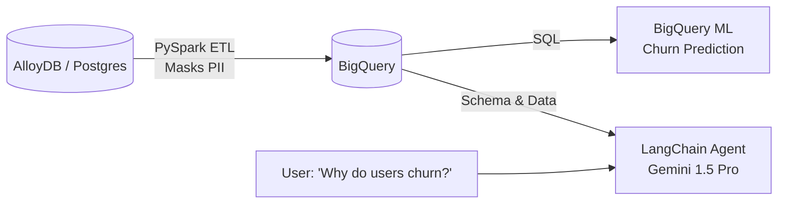

# Agentic Data Foundation on Google Cloud

An end-to-end data platform built on Google Cloud that transforms operational database records into an AI-ready analytical foundation. This project demonstrates data engineering with PySpark, predictive analytics with BigQuery ML, and the deployment of a natural language Text-to-SQL Agent using Gemini.

Secrets are managed by GCP.

## 🏗️ Architecture



## 🚀 Project Highlights

* **Phase 1: Data Engineering (PySpark & Dataproc)**
  * Extracted operational data from AlloyDB using a PostgreSQL JDBC driver.
  * Performed structural transformations and cryptographic hashing to **de-identify sensitive PII** (customer IDs).
  * Loaded processed data into BigQuery analytics tables using Dataproc Serverless.
* **Phase 2: Applied Machine Learning (BigQuery ML)**
  * Trained and evaluated a Logistic Regression model natively in BigQuery using standard SQL.
  * Predicted customer churn probability based on historical tenure and billing metrics.
* **Phase 3: Agentic GenAI (LangChain & Gemini)**
  * Built a ReAct (Reason + Act) autonomous agent using Python, LangChain, and the Google Gemini API.
  * The agent dynamically reads BigQuery schemas, formulates valid Google Standard SQL, executes queries, and synthesizes answers in natural language.

## 📂 Repository Structure

```text
├── data/                               # Synthetic data generation scripts
├── data_engineering/                # PySpark ETL scripts and AlloyDB DDL
├── machine_learning/                # BQML Training and Prediction SQL scripts
├── agentic_ai/                      # LangChain Text-to-SQL Agent
├── requirements.txt                    # Python dependencies
└── README.md                           
```

## 💻 Sample Agent Execution

By leveraging LangChain's SQL toolkit, the agent autonomously explores the database without any hardcoded SQL:

```text
$ python agentic_ai/text_to_sql_agent.py
Initializing Agent via AI Studio...

Question: What is the average tenure of customers who churned versus customers who did not churn?

> Entering new SQL Agent Executor chain...
Invoking: `sql_db_list_tables` with `{}`
synthetic_telco_churn

Invoking: `sql_db_schema` with `{'table_names': 'synthetic_telco_churn'}`
CREATE TABLE synthetic_telco_churn ( ... )

Invoking: `sql_db_query` with `{'query': 'SELECT Churn, AVG(tenure) AS average_tenure FROM synthetic_telco_churn GROUP BY Churn'}`
[('Yes', 9.4), ('No', 48.2)]

I now have the results of the SQL query. Customers who churned have a significantly lower average tenure.

> Finished chain.
==================================
Final Answer: The average tenure of customers who churned is 9.4 months, whereas the average tenure of customers who did not churn is 48.2 months. 
==================================
```

## 🛠️ Quick Start

**1. Create a virtual environment and install dependencies:**
```bash
python3 -m venv venv
source venv/bin/activate
pip install -r requirements.txt
```

**2. Configure Environment Variables:**
Fill in your GCP Project ID, BigQuery Dataset, and Gemini API Key in your local environment:
```text
GOOGLE_CLOUD_PROJECT=your_project_id
BIGQUERY_DATASET=your_dataset_name
GEMINI_API_KEY=AIzaSy...
```

**3. Run the Agent:**
```bash
python agentic_ai/text_to_sql_agent.py
```
